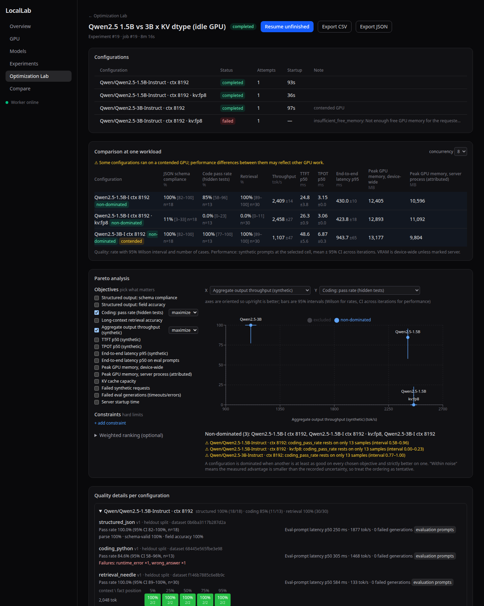
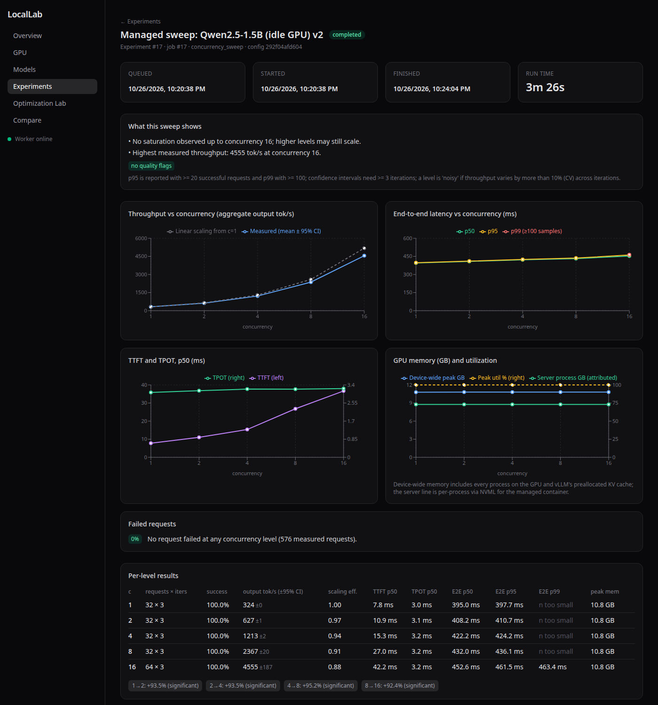
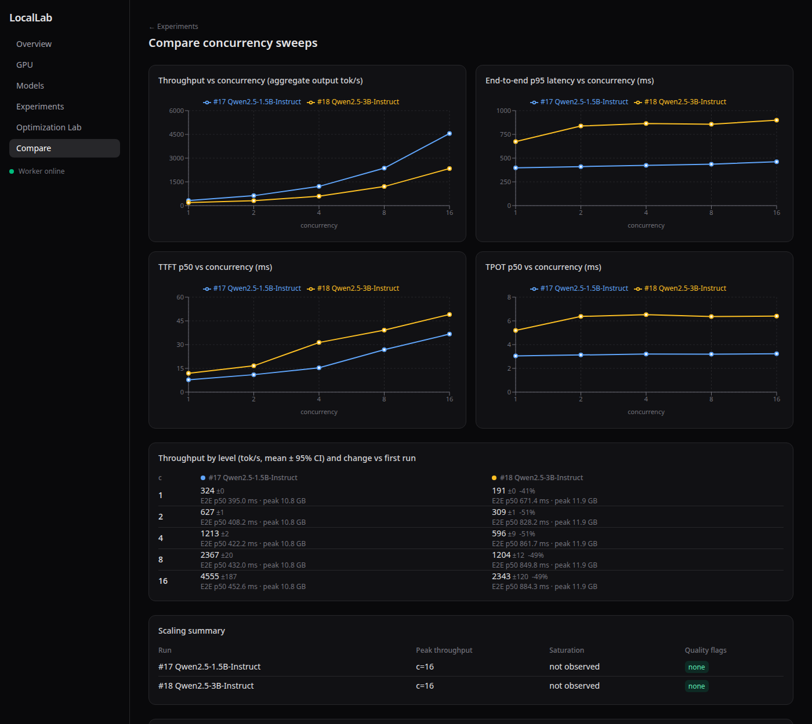
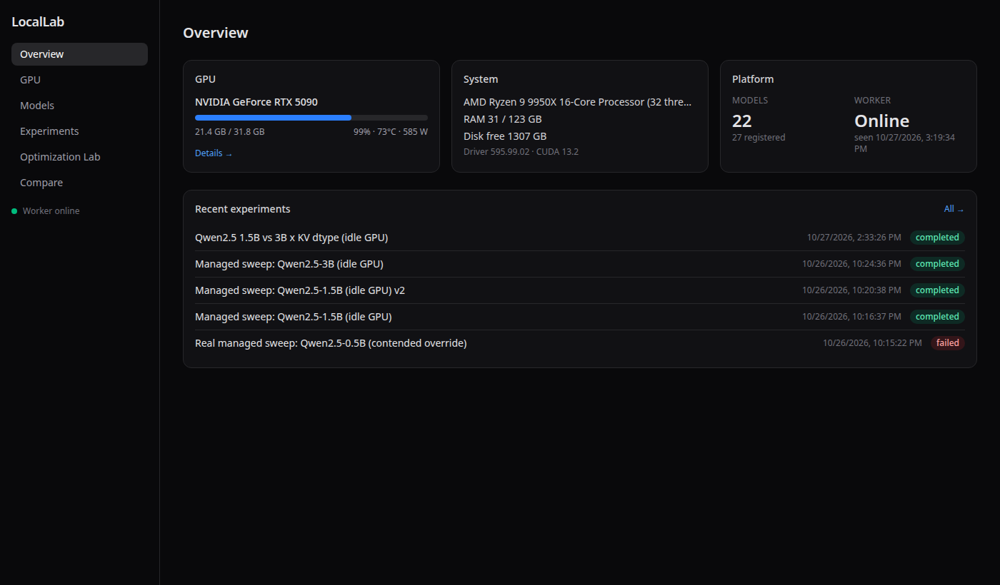
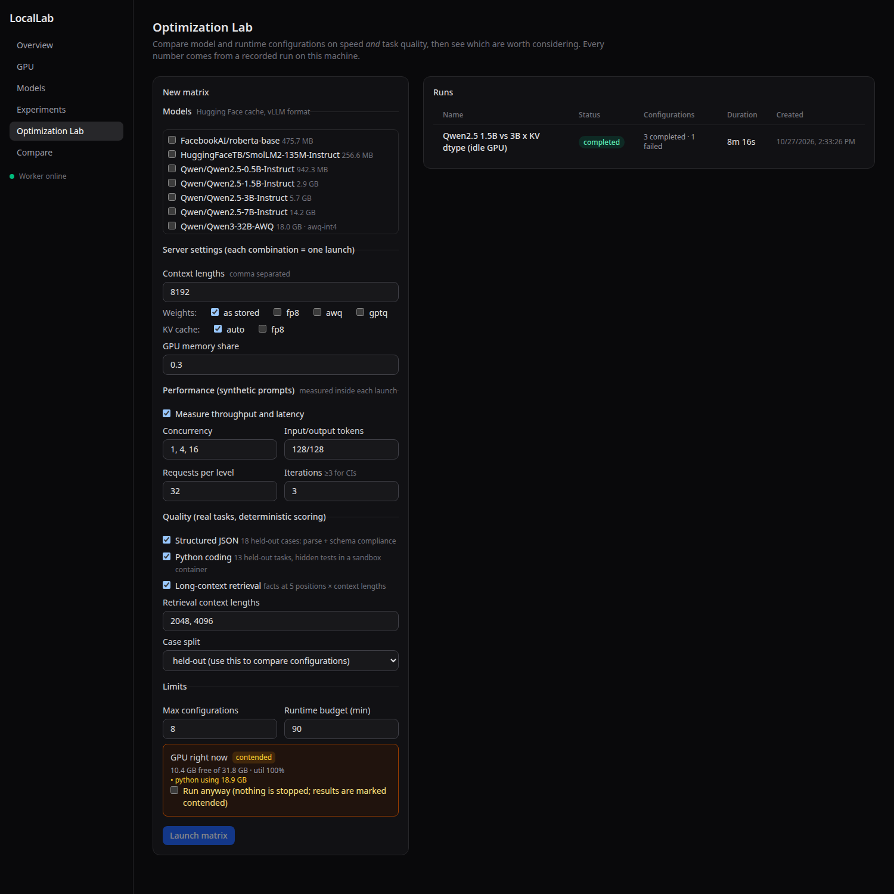
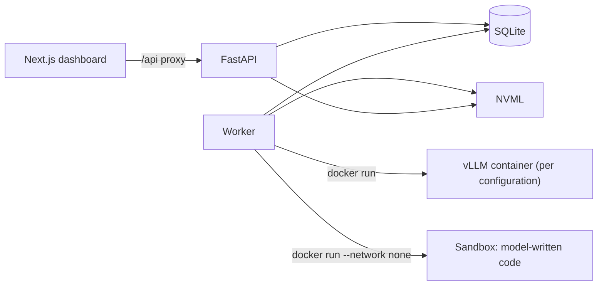

<h1 align="center">LocalLab</h1>

<p align="center">
  <b>Benchmark, evaluate and optimize local LLMs on your own GPU.</b><br>
  Managed vLLM serving · concurrency sweeps · task-quality evals · Pareto analysis
</p>

<p align="center">
  
  
  
  
  
  
</p>

<p align="center">
  
</p>

LocalLab turns a single GPU workstation into an experimentation platform. Pick models and settings, and it launches an isolated vLLM container for each configuration, measures **speed** and **task quality** against that same server, saves everything, and shows you which configurations are actually worth running. No cloud, no fake numbers: every figure in the dashboard comes from a recorded run on your machine.

## Why it exists

Speed benchmarks alone can mislead. In this project's own first optimization run, an FP8 KV cache on Qwen2.5-1.5B doubled KV capacity at *identical* throughput, so a speed-only benchmark would have called it free. The quality evals showed the model had been wrecked:

| Qwen2.5-1.5B | JSON schema | Coding (hidden tests) | Long-context retrieval | Throughput (c=8) | KV capacity |
|---|---|---|---|---|---|
| default KV cache | 18/18 | 11/13 | 30/30 | 2409 tok/s | 224k tokens |
| **FP8 KV cache** | **2/18** | **0/13** | **0/30** | 2458 tok/s | 447k tokens |

*RTX 5090, vLLM 0.16.0, held-out eval cases, 95% intervals in the dashboard. Uses vLLM's default (uncalibrated) FP8 KV scaling.*

## Features

### Optimization Lab: compare configurations on speed *and* quality
- **Matrix experiments** over model × context length × weight quantization × KV-cache dtype, with per-configuration feasibility checks before anything launches.
- **One server launch per configuration.** Concurrency levels, input/output lengths and every eval run inside that launch, so performance and quality in a result always describe the *same* configuration. The server restarts only when something it loads changes.
- **Failure isolation and resume.** Each configuration is saved as it finishes. A crash, OOM, timeout or cancellation never discards the others; **Resume** re-runs only what's unfinished. Limits for configuration count and runtime budget.
- **Pareto analysis you control.** Choose objectives and hard constraints; see non-dominated and dominated configurations with notes on whether each dominance exceeds the measurement uncertainty. There is no hidden composite score: a weighted ranking appears only if you supply weights, and it shows its formula.
- Interactive scatter with 95% intervals, retrieval heatmaps, failure analysis (server logs, failing cases) and CSV/JSON export.

### Quality evals with deterministic scoring (no LLM judge)
| Suite | What it checks | Scoring |
|---|---|---|
| **Structured JSON** | Extract facts into JSON with nested objects, optional/nullable fields, enums and patterns | Strict parse, JSON Schema validation, field accuracy against a reference |
| **Python coding** | 20 small tasks (13 held-out) | Hidden unit tests run in a locked-down container: no network, read-only filesystem, 512 MB / 1 CPU / 64 PIDs, all capabilities dropped, non-root |
| **Long-context retrieval** | A fact hidden at 5 positions across several context lengths, with distractors | Exact match; prompt length is calibrated with the server's tokenizer and the server-reported size is stored |

Datasets have stable case IDs, versions and fingerprints. Comparisons default to the **held-out** split, and every coding task ships a reference solution that the tests run against its own hidden asserts.

### Managed vLLM serving and concurrency sweeps
<p align="center"></p>

- **LocalLab runs the server for you.** It launches a labelled `vllm/vllm-openai` container (model cache mounted read-only, port bound to localhost, `no-new-privileges`), waits for readiness, benchmarks, and always removes it, even on cancellation or a worker crash.
- **Sweeps with statistics, not just lines.** Default levels 1, 2, 4, 8, 16 with warmup and repeated iterations; 95% confidence intervals, scaling efficiency, saturation detection, and p95/p99 reported only when the sample size supports them.
- **Honest memory numbers.** Peak GPU memory is device-wide; for managed servers LocalLab also attributes per-process memory via NVML and labels which is which.
- **Contention-aware.** A GPU preflight checks free memory and other compute processes before every launch. A busy GPU blocks the run unless you explicitly override, results are then permanently marked *contended*, and nothing is ever killed.

<p align="center"></p>

### The platform underneath
- **Persistent jobs.** A separate worker runs a SQLite-backed queue (`queued → preparing → running → completed | failed | cancelled`) that survives API restarts. A job is never marked successful unless it actually completed; stale jobs from a dead worker are failed, not completed.
- **Reproducibility by construction.** Every run records its config and hash, seed, model revision, image digest, exact container command, hardware, driver/CUDA and package versions, git commit, and per-request measurements.
- **Safe by default.** No endpoint accepts commands; Docker is driven with fixed argument lists, and LocalLab only ever stops containers carrying *its own* labels and install ID. Orphans from a crashed worker are reconciled automatically.
- **Real telemetry.** GPU metrics come from NVML; if it's unavailable the UI says so rather than showing anything made up.

<table>
  <tr>
    <td width="50%"><br><sub>Overview: live GPU, system and recent experiments</sub></td>
    <td width="50%"><br><sub>Matrix builder with live GPU contention check</sub></td>
  </tr>
</table>

## How it works



For each configuration the worker validates it, re-checks the GPU, launches a server, runs the synthetic performance cells and the quality evals against it, persists one result row, and removes the container. More detail in [docs/architecture.md](docs/architecture.md).

## Quick start

**Requirements:** Linux with an NVIDIA GPU and driver, Python ≥ 3.11, Node ≥ 20. For managed serving and the coding sandbox: Docker with the `nvidia` runtime and the `vllm/vllm-openai` image already pulled (LocalLab never pulls images). Models are served from your local Hugging Face cache.

```bash
cp .env.example .env     # optional; defaults work
make setup               # venv + pip + npm install
make api                 # migrations, then http://127.0.0.1:8321  (docs at /docs)
make worker              # executes queued jobs
make web                 # dashboard at http://localhost:3210
```

Then open the dashboard, go to **Models → Scan for models**, and try **Optimization Lab → New matrix**, or **Experiments → Concurrency sweep**.

<details>
<summary>Other ways to use it, and configuration</summary>

- **Benchmark a server you already run:** *Experiments → Inference benchmark* or a sweep in *External* mode. `scripts/run_vllm_server.sh <model> <name>` starts a throwaway vLLM container, including a workaround for a CUDA "Error 803" (the image's bundled `libcuda` shadowing a newer host driver).
- **Remote access:** the dashboard proxies the API, so one port is enough: `ssh -L 3210:localhost:3210 you@workstation`. Both services bind to localhost by default and there is **no authentication yet**, so keep it on a trusted network.
- **Key settings** (see `.env.example`): `LOCALLAB_API_PORT`, `LOCALLAB_ALLOWED_RUNTIME_HOSTS` (hosts experiments may send inference traffic to), `LOCALLAB_VLLM_IMAGE`, `LOCALLAB_SANDBOX_IMAGE`, `LOCALLAB_RECONCILE_INTERVAL_S`.
- **Ports** 8321 (API) and 3210 (dashboard) avoid common services such as Open WebUI and Ollama.

</details>

## Development

```bash
make test    # 204 backend tests: unit, mock-vLLM and fake-Docker integration, scoring, Pareto
make lint    # frontend lint + typecheck
make build   # frontend production build
```

Most tests run against an in-process mock of vLLM's OpenAI-compatible API and an in-memory fake Docker, covering lifecycle, cancellation, crash recovery, cleanup, failure isolation, resume and persistence. Real-GPU benchmark runs were done separately on the RTX 5090.

**Layout:** `backend/locallab/` (`api/`, `services/`, `runtimes/`, `experiments/`, `evals/`, `analysis/`, `worker/`, `models/`) · `frontend/` (Next.js App Router, Tailwind, Recharts) · `docs/` · `scripts/`.

## Docs

- [Architecture and design decisions](docs/architecture.md)
- [Roadmap](docs/roadmap.md)

## Status and limitations

Built and tested on one machine (Ubuntu 24.04, RTX 5090, driver 595, vLLM 0.16.0). Currently vLLM only, one GPU, no authentication. Quality results come from small eval sets (18 JSON, 13 coding, 30 retrieval cases per configuration) and a single greedy run, so wide intervals are expected and shown. Coding answers run in a locked-down container, but model code shares a process with the test harness, which is fine for non-adversarial local models and is not a security boundary.

## License

[MIT](LICENSE)
